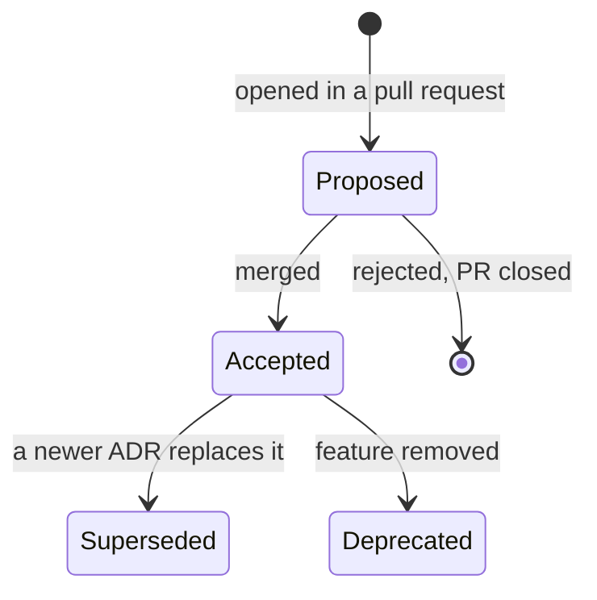
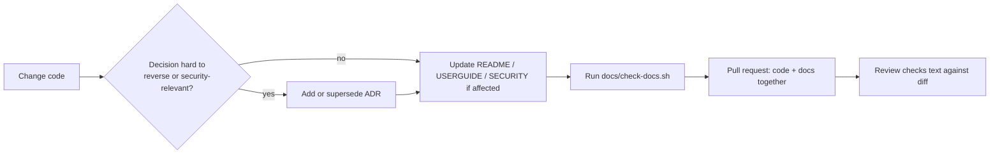

# Docs as code

Documentation in this repository is treated like source code: plain text in git,
changed through pull requests, checked by a script, and kept next to the code it
describes. This page defines how.

## Principles

1. **Docs live in the repo.** Markdown files, versioned with the code. No wiki,
   no separate document store that can drift from the release it describes.
2. **One change, one pull request.** A change to behaviour, a file format,
   cryptography, SPV validation or key handling updates the affected docs in the
   same commit. `SECURITY.md` is the published threat model and must stay accurate
   (see `CLAUDE.md`, *Working rules*).
3. **Review docs like code.** Reviewers check that the text matches the diff.
4. **English only** for documentation, comments and commit messages.
5. **Diagrams are text.** Use Mermaid code blocks, which render on GitHub and diff
   cleanly. No binary diagram files unless a tool cannot export text.
6. **Prefer links to copies.** Point to the code path or the ADR instead of
   restating it, so there is one place to update.
7. **Check mechanically.** `docs/check-docs.sh` runs the checks below; run it
   before committing documentation changes.

## Where things go

| What | Where | Audience |
|------|-------|----------|
| Project overview, build and run, test | `README.md` | Developers |
| End-user manual | `USERGUIDE.md` | Users |
| Threat model, crypto parameters, SPV trust | `SECURITY.md` | Users, reviewers |
| What shipped in each release | `CHANGELOG.md` | Everyone |
| Why the design is the way it is | `docs/adr/` | Maintainers, reviewers |
| This process | `docs/docs-as-code.md` | Contributors |
| Build, signing and release procedure | `docker/README.md`, `docker/keystore/README.md` | Release managers |
| Rules for coding agents | `CLAUDE.md` and `AGENTS.md` (kept identical apart from their header) | Agents |

Rule of thumb: *what* and *how* belong to the README, user guide and code comments;
*why this and not the alternative* belongs to an ADR.

## Architecture Decision Records

One ADR per feature or significant decision, in `docs/adr/NNNN-slug.md`, written
from `docs/adr/template.md`. The index is `docs/adr/README.md`.

**When to write one.** Add or change an ADR when a change:

- introduces a feature or subsystem;
- touches cryptography, SPV validation, key or seed handling, or the file format;
- is hard to reverse, or someone is likely to ask "why not X?" later.

Bug fixes and refactors that keep the decision intact do not need an ADR.

**Lifecycle.**

- Number ADRs sequentially; never reuse or renumber.
- Do not rewrite the substance of an Accepted ADR. To change a decision, write a
  new ADR, set the old one's status to `Superseded by [NNNN](NNNN-slug.md)` and
  link back from the new one. Typos and broken links can be fixed in place.
- Keep each ADR short: context, decision, consequences, references.
- Reference code by repository-relative path in backticks. The check script
  verifies these paths still exist, so a rename shows up as a docs failure.

## Workflow

1. Make the code change.
2. Decide whether an ADR is needed (see above) and write or supersede it.
3. Update `README.md`, `USERGUIDE.md`, `SECURITY.md` and `CHANGELOG.md` where the
   change affects them. If you edit `CLAUDE.md`, mirror the edit into `AGENTS.md`.
4. Run `docs/check-docs.sh`.
5. Commit code and docs together and open the pull request.

## What `docs/check-docs.sh` verifies

- Every ADR file is named `NNNN-slug.md`, numbers are unique and contiguous.
- Every ADR has a title line matching its number, a `Status`, and the sections
  *Context*, *Decision*, *Consequences*.
- Every ADR is listed in `docs/adr/README.md`, and every index row points to a file.
- Repository paths cited in backticks (`src/…`, `tests/…`, `docker/…`, root files)
  exist.
- Relative Markdown links in `docs/` resolve.
- `CLAUDE.md` and `AGENTS.md` match apart from their header block.

It needs only `bash` and standard tools, so it runs on a developer machine and can
be wired into CI later (the repository has no CI workflow today).

## Possible next steps (not in place yet)

- Run `docs/check-docs.sh` and a Markdown linter in a CI workflow on pull requests.
- Add a link checker for external URLs.
- Publish `docs/` as a static site if the audience outgrows GitHub's renderer.
